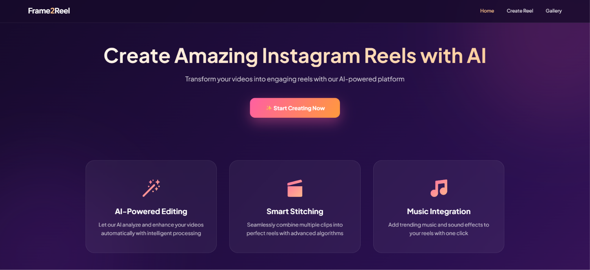
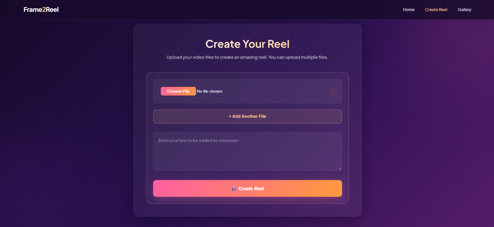
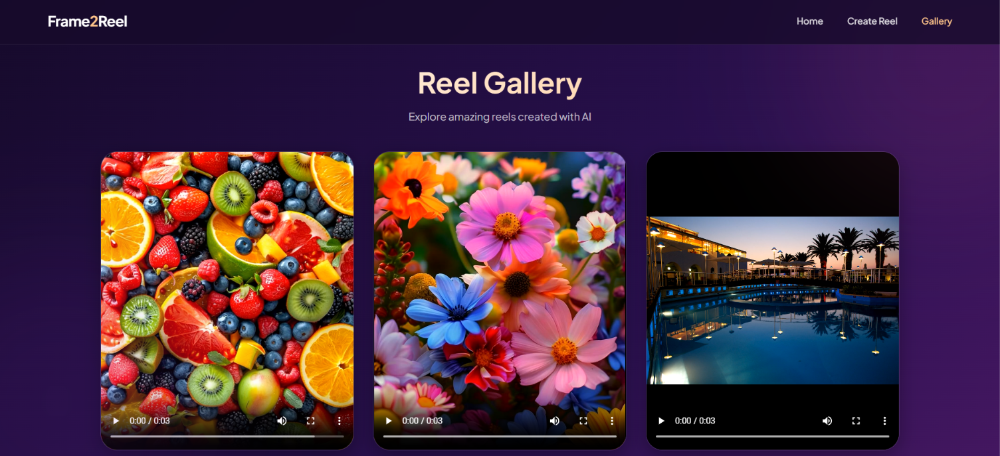

# Frame2Reel 🎬
**Frame2Reel** is an AI-powered reel generator that turns your images and a short text description into a vertical (1080x1920) video with an AI voice-over. It combines text-to-speech, FFmpeg media processing and a simple Flask web interface, so creating a reel takes just a few clicks.

## Demo Images

  
*The home page of the Frame2Reel web app*

  
*Where users upload images and add the voice-over text*

  
*The gallery with generated reels*

---

## Features ✨
- **Text-to-Speech Voice-over**: Converts your text into natural speech using ElevenLabs.

- **Smart Stitching**: Combines multiple images into one reel, shown in sequence.

- **Reel-Ready Format**: Output is scaled and padded to 1080x1920 (9:16) at 30 fps, ideal for Instagram Reels, Shorts and TikTok.

- **Multi-File Upload**: Add as many images as you like (PNG, JPG, JPEG).

- **Reel Gallery**: Browse all generated reels in one place.

- **Simple Web Interface**: Built with Flask and a modern dark UI.

---

## Tech Stack 🛠️

- **Python** – Backend logic and automation
- **Flask** – Web framework for the interface
- **ElevenLabs** – AI-powered text-to-speech
- **FFmpeg** – Video and audio processing
- **HTML/CSS/JS** – Frontend design

---

## Project Structure 📁

```
Frame2Reel/
├── main.py                # Flask app (routes: home, create, gallery)
├── generate_process.py    # Text-to-audio + FFmpeg reel creation
├── text_to_audio.py       # ElevenLabs text-to-speech helper
├── config.py              # Loads the API key from .env
├── templates/             # HTML pages
├── static/
│   ├── css/               # Stylesheets
│   └── reels/             # Generated reels (git-ignored)
├── user_uploads/          # Uploaded images and audio (git-ignored)
├── docs/screenshots/      # README images
├── .env.example           # Template for your API key
└── requirements.txt
```

---

## Prerequisites 📋

- Python 3.10 or newer
- [FFmpeg](https://ffmpeg.org/download.html) installed and added to your PATH
- An [ElevenLabs](https://elevenlabs.io) API key

---

## Installation 💻

1. Clone the repository:

```
git clone https://github.com/Ctirth/Frame2Reel
cd Frame2Reel
```

2. Create a virtual environment and activate it:

```
python -m venv venv
source venv/bin/activate   # Linux/Mac
venv\Scripts\activate      # Windows
```

3. Install dependencies:

```
pip install -r requirements.txt
```

4. Add your API key:

```
cp .env.example .env       # Linux/Mac
copy .env.example .env     # Windows
```

Open `.env` and replace the placeholder with your key:

```
ELEVENLABS_API_KEY=your_elevenlabs_api_key_here
```

> ⚠️ Never commit your `.env` file. It is already listed in `.gitignore`.

5. Run the Flask app:

```
python main.py
```

Then open **http://127.0.0.1:5000** in your browser.

---

## Usage 🎥

1. Open the **Create Reel** page.

2. Upload your images (use **+ Add Another File** for more).

3. Type the text you want spoken as the voice-over.

4. Click **Create Reel** and wait while the audio and video are generated.

5. Watch your reel on the **Gallery** page. Generated files are saved in `static/reels/`.

---

## How It Works ⚙️

1. Your images and text are saved in a unique folder inside `user_uploads/`.

2. The text is sent to ElevenLabs and returned as `audio.mp3`.

3. FFmpeg joins the images and the audio into a vertical MP4 reel.

4. The reel is stored in `static/reels/` and shown in the gallery.

---

## Contribution 🤝

Contributions are welcome!

- Fork the repo

- Create your feature branch: `git checkout -b feature-name`

- Commit your changes: `git commit -m "Add new feature"`

- Push to the branch: `git push origin feature-name`

- Open a Pull Request

---

